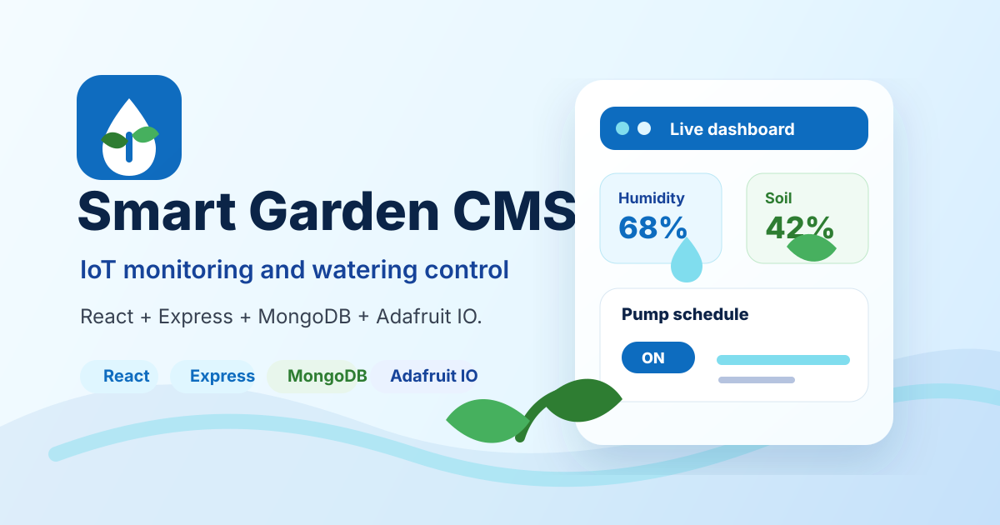
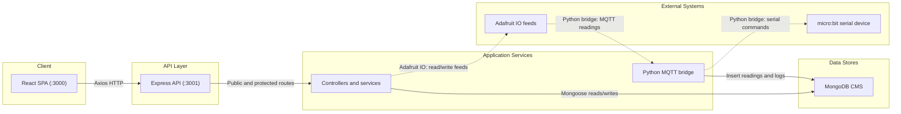

# Smart Garden CMS



Smart Garden CMS is a full-stack monitoring and watering-control app. The React client shows live sensor values, charts, logs, pump controls, and threshold settings. The Express API authenticates users, reads sensor and pump data from Adafruit IO, stores historical records in MongoDB, and sends pump commands back to Adafruit IO.

## Architecture



## Repository Layout

```text
client/                 React 19 + Vite app
server/                 Express 5 API, Mongoose models, Vitest tests
L01_CNPM_10.py          Optional Adafruit IO / MongoDB / micro:bit bridge script
```

## Main Features

- User registration and login with JWT access tokens.
- Dashboard for latest temperature, humidity, light, soil-moisture, environment-dryness, and pump values.
- Historical charts for sensor readings.
- Daily activity log lookup.
- Threshold updates for each sensor type.
- Manual pump on/off commands.
- Automatic watering timer create, update, delete, and list operations.

## Requirements

- Node.js and npm for the client and server.
- MongoDB database named `CMS` or a full `DATABASE_URL`.
- Adafruit IO username, AIO key, and feed names for each user.
- Python dependencies only if running `L01_CNPM_10.py`: `Adafruit_IO`, `pymongo`, `python-dotenv`, and `pyserial`.

## Server Setup

Create `server/.env`:

```env
DATABASE_URL=mongodb://localhost:27017/CMS
DATABASE_USERNAME=your_mongodb_username
DATABASE_PASSWORD=your_mongodb_password
JWT_SECRET=replace_me
```

`DATABASE_URL` is used when present. If it is missing, the server builds a MongoDB Atlas URL from `DATABASE_USERNAME` and `DATABASE_PASSWORD`.

Run the API:

```bash
cd server
npm install
npm start
```

The API listens on `http://localhost:3001`.

## Client Setup

```bash
cd client
npm install
npm run dev
```

The client runs on `http://localhost:3000` and currently calls the API at `http://localhost:3001`.

## Python Bridge Setup

Create `.env` in the repository root if you use `L01_CNPM_10.py`:

```env
AIO_USERNAME=your_adafruit_io_username
AIO_KEY=your_adafruit_io_key
DATABASE_USERNAME=your_mongodb_username
DATABASE_PASSWORD=your_mongodb_password
```

The script subscribes to Adafruit IO feeds, writes readings and logs into MongoDB, and forwards payloads to a connected micro:bit serial device when available. Treat it as prototype bridge code: it contains hard-coded feed IDs and a hard-coded sample user lookup, and `processData` needs cleanup before production use.

## API Summary

Public routes:

| Method | Path | Purpose |
| --- | --- | --- |
| `POST` | `/login` | Validate username/password and return `api_token`. |
| `POST` | `/register` | Create a user with MQTT username and Adafruit IO key. |

Authenticated routes require `Authorization: Bearer <api_token>`.

| Method | Path | Purpose |
| --- | --- | --- |
| `GET` | `/sensors/humid` | Latest humidity value and threshold status. |
| `GET` | `/sensors/light` | Latest light value and threshold status. |
| `GET` | `/sensors/temp` | Latest temperature value and threshold status. |
| `GET` | `/sensors/moisture` | Latest soil-moisture value and threshold status. |
| `GET` | `/sensors/ed` | Latest calculated environment-dryness value. |
| `GET` | `/sensors/chart/humid` | Historical humidity values. |
| `GET` | `/sensors/chart/light` | Historical light values. |
| `GET` | `/sensors/chart/temp` | Historical temperature values. |
| `GET` | `/sensors/chart/moisture` | Historical soil-moisture values. |
| `GET` | `/sensors/chart/ed` | Historical environment-dryness values. |
| `PUT` | `/sensors/threshold/humid?upper=&lower=` | Update humidity thresholds. |
| `PUT` | `/sensors/threshold/light?upper=&lower=` | Update light thresholds. |
| `PUT` | `/sensors/threshold/temp?upper=&lower=` | Update temperature thresholds. |
| `PUT` | `/sensors/threshold/moisture?upper=&lower=` | Update soil-moisture thresholds. |
| `GET` | `/logs?date=YYYY-MM-DD` | Get logs for one day. |
| `GET` | `/waterpumps` | Get latest pump state from Adafruit IO. |
| `POST` | `/waterpumps/manual/on` | Publish `ON` to the configured pump feed. |
| `POST` | `/waterpumps/manual/off` | Publish `OFF` to the configured pump feed. |
| `GET` | `/waterpumps/auto` | List automatic watering timers. |
| `POST` | `/waterpumps/auto` | Create a timer with `startTime` and `endTime`. |
| `PUT` | `/waterpumps/auto/:id` | Update a timer. |
| `DELETE` | `/waterpumps/auto/:id` | Delete a timer. |

## Data Model Notes

The API uses Mongoose models for users, sensor configuration, sensor history, environment dryness, logs, pump history, and pump timers. Sensor and pump calls depend on a `Sensors` document for the authenticated user because that document stores threshold values and Adafruit IO feed names:

- `lightFeedName`
- `humidityFeedName`
- `moistureFeedName`
- `temperatureFeedName`
- `waterPumpFeedName`

Registration creates the user account, but the current code does not create the matching `Sensors` document automatically.

## Tests and Linting

Server:

```bash
cd server
npm test
npm run lint
```

Client:

```bash
cd client
npm test
npm run lint
```
